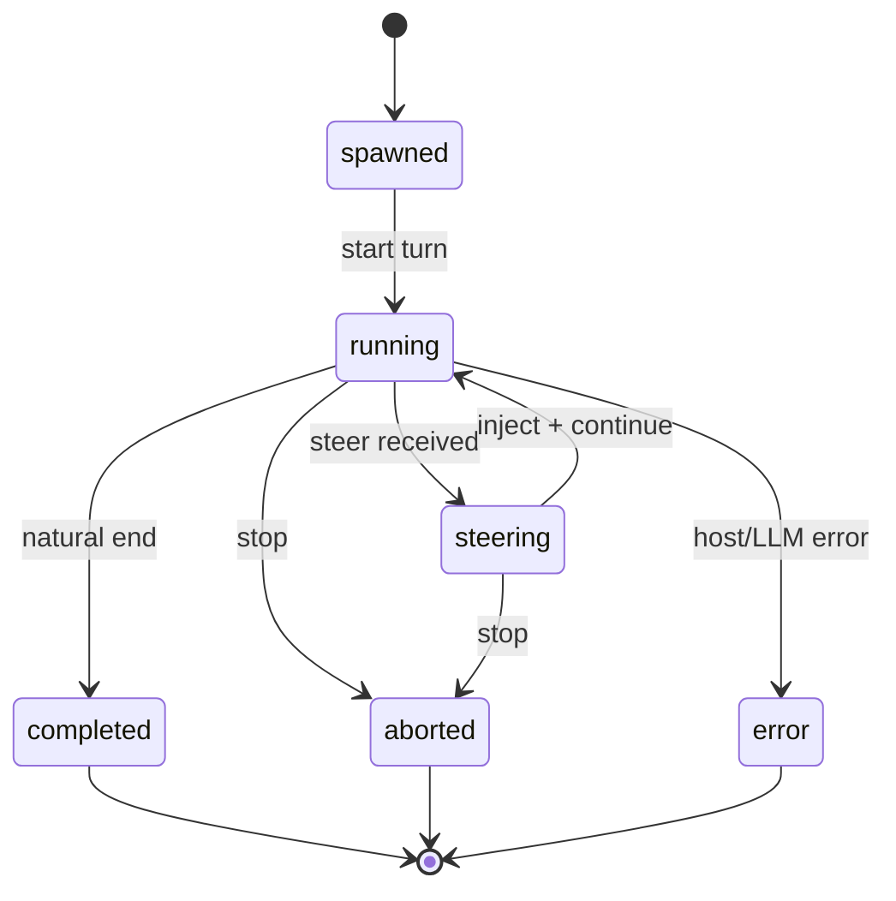

# PRD: Always-On Multitask Dispatcher for dsh (DeepSeek Harness)

| Field | Value |
|---|---|
| Document | PRD / design |
| Status | Draft for implementation |
| Host product | **dsh** (DeepSeek Harness) — existing local CLI/agent host |
| Pattern reference | Sand-style always-on dispatcher (architecture only) |
| Language of implementation | **TypeScript** (required — dsh plugin surface); see §8 |
| Legal posture | **No verbatim copy** from the reference reconstruction; **adapted copying permitted** (ADR-0018 exception B9, human accepted-risk decision 2026-09-18 — operative wording in AGENTS.md "Reference-tree copying policy" and §3 below). |

---

## 1. Problem

A single agent turn often blocks the chat: research, builds, long tool loops. The user still needs to talk, redirect, or cancel while work runs. The product goal is **one person, many streams**: a dispatcher that stays responsive and runs heavy work in parallel workers, then delivers results as they land.

This is **not** “more subagents.” It is a **policy + wake/steer contract** on top of dsh’s existing spawn / followup / jobs / todo machinery.

---

## 2. Goals

1. **Always-on dispatcher** in the primary 1:1 chat: short turns, always available.
2. **Blank workers**: each independent stream gets its own worker; prompt is self-contained; workers do not inherit dispatcher memory or user chat.
3. **Parallel streams**: several workers + at most one inline mini-job; never serialize independent work for UI tidiness.
4. **Mid-run steer**: inject a correction into a *running* worker without restart (context preserved).
5. **Async chat**: user messages answered in seconds even while workers are busy.
6. **Completion delivery**: worker finish **wakes** the dispatcher; dispatcher reconciles todos and delivers results to the user (never “fire and forget forever”).
7. **Peer agents (optional Phase 2)**: multi-bot messaging with async wake, not live RPC.
8. **Local-first**: everything local except LLM API; no remote compute requirement.
9. **No verbatim copy**: implement from this PRD + public behavior description; adapted copying from the reconstruction is permitted, verbatim text is not (amended 2026-09-18, ADR-0018).

### Non-goals

- Rebuilding dsh’s inference router, transcript storage, or tool runtime.
- Remote sandbox product / remote desktop parity.
- Bit-for-bit Sand/Cursor/Grok Bot UI or binary compatibility.
- Copying any file, string, class, or algorithm implementation from the reconstruction repo.

---

## 3. Copy constraints (hard requirements)

> **Amended 2026-09-18 (ADR-0018, exception B9 — supersedes the original clean-room text):** the reference reconstruction is **public with unknown upstream provenance**; the human accepted the residual risk. The operative rule is the **no-verbatim copy policy** (AGENTS.md, "Reference-tree copying policy"): no verbatim copying of source, prompts, tool strings, identifiers, or protocol artifacts; **adapted copying — restructured, independently named, not textually identical — is permitted**. This is a human accepted-risk decision, not a legal clearance.

| Allowed | Forbidden |
|---|---|
| Read architecture notes and this PRD | Verbatim copy/paste of any source, prompts, tool strings, identifiers, or protocol artifacts |
| Name *capabilities* (dispatch, steer, wake, todo queue) — as quality, not compliance | Vendoring or shipping extracted modules as dependencies |
| Map concepts to dsh APIs | Porting functions line-by-line or transliterating verbatim |
| **Adapted copying** — restructured, independently named, not textually identical | Treating this policy as a license clearance |

**Process**

1. **Spec writer** (this PRD) may analyze the reference tree and describe behavior abstractly.
2. **Implementers** work from this PRD and dsh public APIs/docs; the reconstruction tree may be read and **adapted** (restructured, independently named, never textually identical — see AGENTS.md "Reference-tree copying policy").
3. Prompt text in product is **new or adapted copy** written for dsh (ZH/EN as needed), never textually identical to reference prompt strings.
4. Implementation language is **TypeScript** because dsh plugins are TypeScript/Cordis (§8). Language split is **not** a legal defense; the no-verbatim rule applies regardless.

---

## 4. Success criteria

| ID | Criterion |
|---|---|
| S1 | While a long worker runs, user messages still get a reply within ~seconds (dispatcher turn stays short). |
| S2 | Two independent requests run as two workers concurrently; neither waits on the other. |
| S3 | Steer message mid-run: worker continues without replaying from zero. |
| S4 | Worker finish wakes dispatcher; dispatcher updates todo and delivers result via user-facing message. |
| S5 | Workers cannot address the user directly; only the dispatcher can. |
| S6 | Dispatcher todo list shows multiple `in_progress` streams and is reconciled on every wake. |
| S7 | ~~No TypeScript file from the reconstruction is imported or vendored into the deliverable.~~ **Voided 2026-09-18 (ADR-0018):** the clean-room identifier grep is no longer a ship gate; the no-verbatim copy policy (§3, AGENTS.md) is the operative rule and naming independence is a quality matter. |
| S8 | Core modules unit-tested without network/LLM (fake wake/steer/complete). |
| S9 | (Phase 2) Peer send is async fire-and-forget with optional priority interrupt of non-user work. |

---

## 5. Actors & roles

```text
                    ┌─────────────────────────────┐
  User ────────────►│  Dispatcher (primary chat)  │◄──── wake (user | job done | peer)
                    │  short turns · todo queue   │
                    └──────────────┬──────────────┘
           spawn (blank)           │           steer / stop / check
           ┌───────────────────────┼───────────────────────┐
           ▼                       ▼                       ▼
     ┌──────────┐            ┌──────────┐            ┌──────────┐
     │ Worker A │            │ Worker B │            │ Worker C │
     │ stream 1 │            │ stream 2 │            │ stream 3 │
     └────┬─────┘            └────┬─────┘            └────┬─────┘
          └──────────── result / error ────────────────────┘
                              │
                              ▼
                    dispatcher wake → deliver to user
```

| Role | Definition |
|---|---|
| **Dispatcher** | The main 1:1 agent. Always multitask-capable. Owns user relationship and delivery. |
| **Worker** | Headless background agent. One stream of work. Full work tools, **no user messaging**. Starts with empty conversational context. |
| **Peer agent** (P2) | Separate persistent agent with its own chat; message via async send, not Task result. |
| **User** | Human in the primary chat (and other agent chats if multi-agent UI exists). |

---

## 6. Product behavior

### 6.1 Dispatcher policy (behavioral, not verbatim prompt)

Injected as system / always-on skill. **Amended 2026-09-18 (ADR-0018, supersedes ADR-0005's session-scoped flag):** there is no dispatcher mode, feature flag, or kill switch — the dispatcher is **always-on**, like the reference; the wrapper window / expanded surface *is* the dispatcher, and everything typed there goes to the dispatcher(s) living there:

- You are a **dispatcher**, not the workhorse.
- Any non-trivial multi-step work → **spawn a worker**; conversational replies and one-step lookups stay inline.
- Independent work → **parallel workers**; never queue B behind A unless they share a stream.
- Follow-up/correction to a running stream → **steer that worker**, do not spawn a clone.
- Every user request → **todo entry** before spawn; `in_progress` when the worker starts; `completed` at **first visible ack** to the user (amended 2026-09-18, ADR-0018 — the stricter "user has the result" criterion is superseded; worker exit alone still completes nothing).
- On every wake: **reconcile todos first** (running / landed / next to dispatch).
- Worker prompts are **self-contained**: goal, constraints, relevant context, success criteria, report format.
- Workers **cannot** message the user; dispatcher always delivers.
- Machinery is invisible to the user: no jargon (no “dispatching an executor”); speak as one busy person.

### 6.2 Worker contract

| Property | Rule |
|---|---|
| Context | Blank. No dispatcher memory, no sibling transcripts, no peer inbox. |
| Tools | Work tools (shell/fs/search/LLM tools as dsh allows). **No** `SendMessage` / user DM. |
| Lifecycle | Running → completed \| error \| aborted. One logical stream per worker while running. |
| Steer | Injected as a steering prompt; interrupt current step; **preserve** conversation/tool context; do not restart. |
| Resume (optional) | Follow-up after finish may re-enter same agent id if dsh supports it; still re-include needed context. |
| Report | Final text is the stream’s report to the dispatcher (structured enough to deliver / act on). |
| Spawning | Workers are **leaves**: only the dispatcher spawns agents; a worker never spawns sub-workers (ADR-0003). |
| Todos | The todo list is the **dispatcher's private ledger** — never passed into a worker's context (a worker has no user-messaging tool, so it cannot legitimately complete an item); a worker's own list stays empty (ADR-0007). |

### 6.3 Tools / commands (dispatcher-visible)

Surface names are **dsh-native**; do not ship Sand tool names.

| Capability | Suggested surface | Semantics |
|---|---|---|
| Spawn stream | existing dsh spawn/task with a **worker** agent type | Blank worker; returns worker id + ack; non-blocking |
| Check | `check_worker` or job status UI + tool | List running workers; detail: elapsed, tool count, recent activity, transcript path |
| Steer | `message_worker` / dsh followup-interrupt | Inject into running worker |
| Stop | `stop_worker` | Abort; no late result revival — late results are dropped, per reference behavior (docs/research/reference-behavior-notes.md) |
| Todos | existing todo tools | Allow **multiple** `in_progress`; reconcile on wake |
| Deliver | existing user message tool | Dispatcher → user only |

### 6.4 Wake model

| Wake source | Dispatcher reaction |
|---|---|
| User message | Reply short; update/ack todos; dispatch or steer as needed |
| Worker completed | Reconcile todo; deliver result; spawn next in that stream if queued |
| Worker error | Report honest state to user; decide retry / steer / drop |
| Worker aborted | Close todo as cancelled; tell user if it was visible work |
| Peer message (P2) | Hidden turn with `[peer]` cue style *concept*; new copy |

**Anti-patterns (explicitly out of policy)**

- Polling workers in a busy loop from the dispatcher turn.
- Opening ack that pretends work finished.
- Batching all results until the end if user is waiting.
- Multiple workers for one stream (duplicate spawns for the same goal).

### 6.5 Todo queue semantics

States: `pending` | `in_progress` | `completed` | `cancelled`.

- **Several** `in_progress` allowed: one per live stream (+ optional one inline).
- `completed` = **first visible ack to the user** (amended 2026-09-18, ADR-0018; formerly the stricter "delivered to user" — that criterion is superseded, but worker exit alone still does not complete an item).
- Stale items cancelled; prune noise; keep list usable.
- Skip todos for pure chat and trivial lookups.

---

## 7. Architecture (learned, not copied)

### 7.1 Component map

```text
┌──────────────────────────────────────────────────────────────┐
│                         dsh host                             │
│  transcript · tool runtime · inference · session store       │
└──────────────────────────────────────────────────────────────┘
         │ spawn/followup/interrupt/jobs/todo (existing)
         ▼
┌──────────────────────────────────────────────────────────────┐
│              Multitask core (NEW, clean-room)                 │
│                                                              │
│  policy prompt assembler     worker registry                 │
│  todo reconciler             completion → wake bus           │
│  steer queue (pending msg)   lifecycle FSM                   │
│  (P2) peer inbox + priority lane                             │
└──────────────────────────────────────────────────────────────┘
         │ thin adapters only
         ▼
   dsh job / agent APIs
```

**Rule:** Multitask core owns **state machines and policy**; dsh owns **processes, LLM calls, storage**.

### 7.2 Lifecycle (worker)



### 7.3 Steer algorithm (conceptual)

1. Steer request arrives for worker `W`.
2. If `W` is running: queue `pending_steer[W]` and request interrupt of current step.
3. On step boundary: if `pending_steer` non-empty, pop one, wrap as steering block (“parent correction; continue; do not restart”), run next step.
4. If multiple steers queued: last-wins or merge—**spec: last-wins** for simplicity; document.
5. If `W` not running: return not-running; do not silently recreate.

### 7.4 Completion → wake

1. Worker settles (completed | error | aborted).
2. Emit `WorkerSettled{worker_id, parent_session, status, result_summary, transcript_ref}`.
3. Wake bus enqueues **wakeup** on dispatcher session (same lane class as dsh job completion).
4. Dispatcher turn: pull wakeups → reconcile todos → deliver or bookkeep.
5. If dispatcher is mid-user-turn, use dsh’s busy-inject policy (do not starve the user).

### 7.5 Data model (minimal)

```text
WorkerRecord {
  worker_id: string
  parent_session_id: string
  stream_key: string          // logical stream (todo id)
  title: string               // short derived title
  status: enum
  started_at_ms: number
  tool_call_count: number     // optional live
  transcript_ref: string | null
  todo_id: string | null
}

TodoItem {
  id, title, status, stream_key?, worker_id?, delivered: bool
}

SteerTicket {
  worker_id, message, created_at_ms
}

// Phase 2
PeerEnvelope {
  from_agent_id, from_name, to_agent_id,
  text, image_refs[], priority: bool,
  created_at_ms
}
```

~~Persistence: **dsh session/job store** first; avoid inventing a second transcript DB. In-memory maps are OK for v1 if process lifetime == session lifetime; document restart loss.~~ ~~**Resolved: durable core state in the dsh session/job store is in scope for v1** — worker records, steer tickets, todo↔worker linkage, and **held results that settle while the dispatcher is toggled OFF** (ADR-0005) persist there and survive restart; still no second transcript DB, never an in-memory-only `WorkerRecord`/`SteerTicket` map in shipped code.~~ **Resolved (amended): match the reference's actual split.** Durable: per-agent transcript/KV state, conversation state including the todo list, and small control-plane obligation markers. In-memory: the worker registry/records and steer tickets — reference recon found these are not persisted (`docs/research/reference-behavior-notes.md`). In-memory state is lost on restart, and the reference handles that by **honest amnesia**: a lost worker is reported as unknown-state pointing at its transcript, never replayed. Still no second transcript DB. The blanket "everything durable in v1" claim is withdrawn; held results are moot because there is no off-while-running state (ADR-0005). **Resolved (Q10): hybrid split — `WorkerRecord` durable minimum-to-reconstruct; `SteerTicket` in-memory** (ADR-0006). Durable is the **minimum needed to rebuild the live roster** across a restart — worker id, transcript pointer, todo link, status — written through the reference's control-plane obligation-marker idiom, so the dispatcher can notice an undelivered result after a restart and finish delivery (S4). `SteerTicket` stays in-memory: a steer is transient by definition (single-slot, last-wins), so persisting it means persisting a value expected to be overwritten and meaningless after a restart. The in-memory half imitates the reference's honest-amnesia restart behavior; the durable half is **our deliberate divergence** from it, not imitation.

### 7.6 Phase 2 — peer agents (optional)

Only if product needs multi-bot:

| Concern | Spec |
|---|---|
| Transport | Async message queue per target agent; fire-and-forget ack |
| Wake | New hidden turn with peer cue (new wording) |
| Priority | Can interrupt non-user lane; never silently drop user |
| Storage | Sender outbound + receiver inbound as normal transcript entries |
| Directory | File or DB of agents: id, name, description |
| Images | Optional later; text first |

Sand-like “full messaging hub” is **out of MVP**. Multitask dispatcher does **not** depend on peers.

---

## 8. Implementation language strategy

**Decision: use TypeScript** for the Multitask core and the dsh integration. dsh (`@deepseek-ai/dsh`) is a TypeScript host on the Cordis plugin framework; plugins register tools and services in-process. A non-TS sidecar would add IPC complexity without improving product fit.

| Layer | Language | Rationale |
|---|---|---|
| **Multitask core** (registry, FSM, steer queue, reconciler, wake bus, policy prompt assembly) | **TypeScript** | Same language as the dsh plugin API; unit-testable without the host |
| dsh adapter (spawn/interrupt/jobs/todo glue, tool registration) | **TypeScript** | Cordis plugins / `ctx.tools.register()` are TS; host owns process APIs |
| Agent Code Mode (`run_code`) | TS or Python (host feature) | Irrelevant to Multitask core language |

> **Amended 2026-09-18 (ADR-0018, exception B9):** the clean-room discipline below is replaced by the **no-verbatim copy policy** — the reconstruction is public with unknown upstream provenance; **no verbatim copying**; **adapted copying is permitted** (restructured, independently named, not textually identical). AGENTS.md ("Reference-tree copying policy") is the operative wording; the human accepted the residual risk. Sharing the implementation language with the reference is fine; sharing text is not.

1. Implementers **may** open, read, and **adapt** reconstruction sources — restructure and rename independently; never reproduce text verbatim (code, prompts, identifiers, protocol artifacts).
2. Design from **this PRD + dsh public docs/API**; the reference is the behavior spec (ADR-0017/0018), not a source to transliterate.
3. Package/type/function names stay written from §7/§16 glossary and our own vocabulary — as quality, not compliance (the old clean-room identifier grep is voided as a ship gate).
4. Prompt assets are **new or adapted copy** (§10), never textually identical to reference prompt strings.

**Hard rule:** no verbatim text from the reconstruction — adapted only (human accepted-risk decision 2026-09-18).

---

## 9. API sketch (clean-room, illustrative)

Names are examples for the PRD—not Sand names.

```ts
// Core (TypeScript — illustrative shapes only)
interface Multitask {
  registerWorker(rec: WorkerRecord): void;
  settleWorker(id: string, status: Status, report: string): void;
  enqueueSteer(id: string, msg: string): void; // last-wins
  popSteer(id: string): string | undefined;
  abortWorker(id: string): void;
  listWorkers(parentSession: string): WorkerView[];
  reconcileTodos(wake: WakeEvent): TodoMutation[];
}

// Host adapter (dsh / Cordis)
interface DshHost {
  spawnWorker(prompt: string, opts: SpawnOptions): Promise<string>;
  interruptWorker(workerID: string): Promise<void>;
  onWorkerSettled(cb: (e: SettledEvent) => void): void;
  requestDispatcherWakeup(sessionID: string): Promise<void>;
}
```

Dispatcher-facing tools map 1:1 onto core calls; do not leak core internals into user-visible strings.

---

## 10. Prompt assets (write new copy)

| Asset | Content requirements |
|---|---|
| Dispatcher system section | Roles in §6.1; user-facing tone rules; privacy of machinery |
| Worker agent definition | Headless, self-contained prompt requirement, report format, no user DM |
| Steer wrapper | “Correction from parent; incorporate; continue from here; do not restart” |
| Todo tool description | Parallel in_progress; reconcile on wake; completed = first-visible-ack (ADR-0018) |
| Check/message/stop tool descriptions | dsh wording; behavior identical to §6.3 |

Deliver as separate files in the product repo (e.g. `prompts/dispatcher.md`). Review for: no Sand phrases, no product-name leaks, bilingual if product requires ZH.

---

## 11. Integration checklist (dsh)

1. Confirm dsh primitive set: spawn, followup/interrupt, job completion wake, todo store, user send.
2. Map Multitask wake bus → dsh job `completionDelivery=wakeup` (or equivalent).
3. Confirm todo allows multiple `in_progress` (if not, extend or bypass with core-local queue + display).
4. Confirm worker agent type can run **without** user-facing send tools.
5. ~~Feature flag: `multitask_dispatcher` ON in the dedicated multitask profile, OFF in stock/default profiles; kill switch not live-applied (ADR-0005).~~ **Voided 2026-09-18 (ADR-0018):** no dispatcher mode, flag, or kill switch — the dispatcher is **always-on**; the wrapper window / expanded surface *is* the dispatcher. No on/off-while-running state exists to define.
6. Telemetry (optional): dispatch count, steer count, time-to-first-reply while busy — no prompt text in telemetry.

---

## 12. Testing plan

| Layer | Tests |
|---|---|
| FSM | spawn→run→steer→complete; abort during steer; double-settle ignored |
| Steer queue | last-wins; empty pop; steer when not running |
| Todo reconciler | parallel in_progress; complete only after first-visible-ack (ADR-0018); cancel stale |
| Wake bus | settle enqueues exactly one wake; parent session routing |
| Adapter (fake dsh) | spawn/interrupt called; user send never called from worker type |
| E2E (manual/script) | long fake worker + rapid user messages; steer mid-run; delivery text |
| Legal QA | ~~grep shipped tree for Sand identifiers / multi-line matches vs reference~~ **Voided 2026-09-18 (ADR-0018)** — replaced by an adapted-copy review: no verbatim text vs the reference (ticket 33's re-scoped review) |

---

## 13. Milestones

| Phase | Scope | Exit |
|---|---|---|
| **M0** | Spec freeze (this PRD); TypeScript in-process plugin confirmed | Team sign-off |
| **M1** | Core FSM + steer + wake bus + unit tests | S8 green |
| **M2** | dsh adapter + worker agent type + tools | S1–S5 demo |
| **M3** | Todos reconcile + policy prompts | S6 demo |
| **M4** | Docs, ZH/EN prompts; adapted-copy review (§12, re-scoped 2026-09-18 — no verbatim text vs the reference; the old clean-room audit and S7 grep gate are voided, ADR-0018) run once the product is mostly finished | Adapted-copy review recorded |
| **M5** (opt) | Peer async messaging | S9 |

---

## 14. Risks & mitigations

| Risk | Mitigation |
|---|---|
| Accidental code/prompt copy (same language as reference) | No-copy discipline: reference reading allowed, independent naming, no shared identifiers or literals, legal grep |
| dsh lacks interrupt-continue | Fall back to “queue steer as next user turn on same agent” (weaker S3) or pick another host primitive |
| Dispatcher thrash (too many short turns) | Policy: one reconcile pass per wake; coalesce wakes |
| Duplicate workers for same stream | `stream_key` uniqueness while running |
| Result never delivered | `delivered` flag; idle reconcile job |
| User spam during heavy load | Priority: user lane always preempts bookkeeping; workers already isolated |

---

## 15. Open decisions (resolve before M1)

1. ~~Core language: Go vs Python vs Rust.~~ **Resolved: TypeScript** (§8).
2. ~~Sidecar vs in-process embed.~~ **Resolved: in-process dsh plugin** (Cordis).
3. ~~Worker `Stop` visibility: silent vs user-visible cancel.~~ **Resolved: imitate reference behavior** (docs/research/reference-behavior-notes.md).
4. ~~Steer conflict policy: confirm **last-wins**.~~ **Resolved: imitate reference behavior — last-wins confirmed** (docs/research/reference-behavior-notes.md).
5. ~~Phase 2 peer agents: in scope for this project or separate PRD?~~ **Resolved: in scope for this project** (ADR-0002).
6. ~~Default feature flag ON/OFF for first release.~~ **Voided 2026-09-18 (ADR-0018; supersedes ADR-0005):** there is no flag and no kill switch — the dispatcher is **always-on**; the wrapper window / expanded surface *is* the dispatcher. Q6 and the held-results half of Q8 are moot a fortiori.
7. ~~Durable `WorkerRecord`/`SteerTicket`.~~ **Resolved: hybrid split.** A **minimum-to-reconstruct `WorkerRecord`** is durable — enough to rebuild the live roster across a restart (worker id, transcript pointer, todo link, status), written through the reference's control-plane obligation-marker idiom, so the dispatcher can notice an undelivered result after a restart and finish delivery (S4). **`SteerTicket` stays in-memory** — a steer is transient by definition (single-slot, last-wins), so persisting it means persisting a value expected to be overwritten. Still no second transcript DB. The in-memory half imitates the reference's honest-amnesia restart behavior; the durable half is **our deliberate divergence** from it (ADR-0006).

---

## 16. Appendix A — Concept glossary (architecture-only)

| Concept | Meaning (no code) |
|---|---|
| Dispatcher | Main chat agent that stays short and delegates |
| Blank worker | Background agent with no prior conversation context |
| Steer | Mid-run parent message; interrupt step; keep context |
| Wake | Event that starts a new dispatcher turn (user, job, peer) |
| Delivery | User-visible completion of a todo stream |
| Stream key | One logical work item shared by todo ↔ worker |

These are **product concepts**. Implementation names must be chosen independently.

---

## 17. Appendix B — Copy policy (amended 2026-09-18, ADR-0018 exception B9)

> Supersedes the original clean-room exclusion list. The reference reconstruction is public with **unknown upstream provenance**; the human accepted the residual risk (2026-09-18). AGENTS.md ("Reference-tree copying policy") is the operative wording.

- **Forbidden:** verbatim copying of any source, tool description strings, system prompt sections, runtime classes/functions, protocol artifacts, or experiment codenames from the reconstruction.
- **Permitted:** **adapted copying** — restructured, independently named, not textually identical (independent naming is a quality rule, not a compliance gate; the old clean-room identifier grep / S7 ship gate is voided).
- This policy is a human accepted-risk decision, **not a legal clearance**. It can only be changed by a **separate** written human decision — not by default.

---

*End of PRD.*
